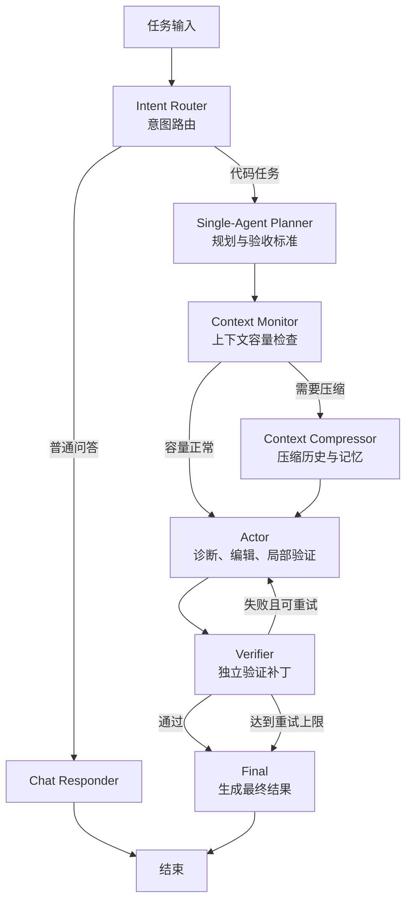
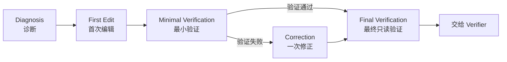
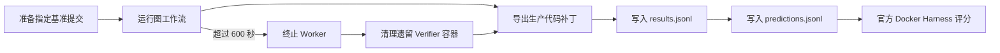

# TacoAgent 编辑流程与节点说明（2026-09-06）

## 1. 总体结构

当前 SWE-bench 单 Agent 编辑流程由两层组成：

1. 图工作流负责意图路由、规划、上下文管理、执行、独立验证和终态输出；
2. Actor 内部状态机负责诊断、首次编辑、最小验证、修正和最终复验。

SWE-bench 运行时设置 `force_workflow=True`，Intent Router 会固定选择代码任务分支。

## 2. 图工作流节点

### 2.1 Intent Router

判断输入属于普通问答还是需要执行代码任务：

- 普通问答进入 Chat Responder；
- 修改代码、运行测试等任务进入 Single-Agent Planner；
- SWE-bench 模式固定进入代码工作流。

### 2.2 Chat Responder

直接生成聊天回答，不绑定文件、命令或编辑工具。该节点在 SWE-bench 评测中通常不会使用。

### 2.3 Single-Agent Planner

将 issue 转换成可执行计划，主要生成：

- 问题目标和初步根因方向；
- 待办事项；
- 验收标准；
- 推荐修改范围；
- 聚焦验证命令；
- 下一节点，通常为 Actor。

Planner 在独立、可终止的子进程中运行。SWE-bench 当前默认硬时间预算为 60 秒；超时后立即
生成包含“定位—生产代码编辑—最小验证”的三步 fallback plan，使 Actor 不依赖 Planner 的
完整输出也能继续工作。

### 2.4 Context Monitor

估算当前消息和记忆占用的上下文 token，并决定是否需要压缩。

默认配置：

- 上下文上限：400,000 tokens；
- 预留空间：16,384 tokens；
- 超过压缩阈值时进入 Context Compressor。

统计优先使用 provider 返回的真实 token usage；不可用时依次退化为模型 tokenizer 和字符数
估算。

### 2.5 Context Compressor

压缩消息历史和持久化任务信息，重点保留：

- 当前任务目标；
- 已完成事项和待办事项；
- 已修改文件；
- 最近验证结果；
- Verifier 失败原因与下一步建议；
- 外部任务记忆索引。

压缩后返回原本计划进入的 Actor、Verifier 或 Final。

### 2.6 Actor

Actor 是实际查看仓库、修改生产代码和执行局部验证的节点。其内部使用严格的分阶段编辑状态机，
详见第 3 节。

Actor 总时间预算当前默认为 300 秒，并需要为 Verifier 预留 120 秒。

### 2.7 Verifier

Verifier 独立检查 Actor 的成果，不直接修改代码。主要职责包括：

- 检查是否存在生产代码补丁；
- 执行 Planner 和 Actor 给出的验证命令；
- SWE-bench 模式下使用官方 Docker 镜像验证；
- 区分测试失败、命令超时和环境不可用；
- 判断补丁是否满足验收标准；
- 失败时生成下一轮 correction 指令。

只有同时满足以下条件才会通过：

- 模型评审判断通过；
- 验证命令没有失败、阻塞或超时；
- SWE-bench 任务产生了实际生产代码修改。

Verifier 失败后，图结构允许返回 Actor 重试；但当前 10 项评测使用 `max_attempts=1`，第一次
Verifier 结束后通常直接进入 Final。

### 2.8 Final

将工作流终态格式化为最终结果：

- 通过时记录完成和验证轮数，并附带 Actor 摘要；
- 未通过时记录验证轮数和 Verifier 给出的失败原因。

## 3. Actor 内部编辑状态机

### 3.1 阶段职责与限制

| 阶段 | 主要工作 | 允许工具 | 默认时间预算 | 默认 token 预算 |
|---|---|---|---:|---:|
| Diagnosis | 定位代码、读取证据、确定修改点 | 读取、搜索、目录查看、命令、记忆查询 | 70 秒 | 20,000 |
| First Edit | 一次受限补读后进行第一次最小生产代码修改 | 最多一次受限 `file_read`/`regex_search`，然后仅 `file_edit`/`file_create` | 70 秒 | 20,000 |
| Minimal Verification | 运行一个最聚焦的验证命令 | `command_run` | 50 秒 | 10,000 |
| Correction | 根据已有失败结果进行一次修正 | `file_edit`、`file_create` | 55 秒 | 14,000 |
| Final Verification | 修正后重跑同一个聚焦验证命令 | `command_run` | 45 秒 | 8,000 |

### 3.2 Diagnosis

目标是用最少证据确定修改位置。编辑工具在此阶段禁用，以减少过早修改。

### 3.3 First Edit

允许最多一次受限 `file_read` 或 `regex_search` 补齐精确编辑上下文；读取最多 12,000 字符，
搜索最多返回 40 条结果。使用该机会后只允许一次聚焦的生产代码编辑，不允许运行测试或继续
探索。

### 3.4 Minimal Verification

只允许运行一次最小相关验证命令。优先使用 Planner 提供且路径有效的第一个验证命令。若模型
在此阶段误发 `file_edit`/`file_create`，调用参数会被缓存，并在 Correction 开始时自动执行，
不再直接丢弃编辑意图。

### 3.5 Correction

如果最小验证失败，允许依据已有失败输出进行一次生产代码修正。该阶段不能重新读取文件或运行
测试；修正后进入 Final Verification。

### 3.6 Final Verification

只读地重跑同一个聚焦失败命令，不允许编辑。修正后的补丁只有在该命令通过后才能被认为已经
局部验证。

## 4. 外层 SWE-bench Runner

Runner 负责：

- 加载指定 SWE-bench Verified 实例；
- 克隆仓库并切换到基准提交；
- 为每个实例创建隔离 workspace；
- 实施单实例 600 秒硬墙钟超时；
- 超时后尽可能导出已有生产代码补丁；
- 清理遗留的 `taco-verifier-*` Docker 容器；
- 记录事件、token、耗时、本地验证状态和补丁；
- 最后调用官方 SWE-bench Docker Harness 评分。

主要本地产物包括：

- `results.jsonl`：逐实例执行结果；
- `predictions.jsonl`：提交给官方 Harness 的补丁；
- `events/*.jsonl`：节点、模型和工具事件流；
- `summary.json`：Agent 阶段汇总；
- `evaluation_report.json`：包含本地和官方结果的综合报告。

## 5. 当前已知瓶颈

### 5.1 阶段与模型操作错位

历史实现的阶段工具限制较严格，导致 `astropy-8872` 和 `django-10554` 没有生成代码。当前
实现已允许 First Edit 做一次受限补读，并会把 Minimal Verification 中误发的编辑延迟到
Correction。Final Verification 中的额外编辑仍不会静默执行，而是要求模型重发允许的验证命令，
避免产生未经复验的第二次修正。

### 5.2 单次模型调用可突破阶段预算

阶段预算只在模型调用前后检查，不能可靠中断正在执行的 provider 调用。一次长调用可能消耗
远超阶段时间或 token 上限，使后续编辑、验证阶段失去执行机会。

### 5.3 仓库准备占用实例总预算

clone、fetch 和 checkout 位于 600 秒实例硬预算内。仓库准备较慢时，会直接压缩 Planner、
Actor 和 Verifier 可用时间。

### 5.4 当前评测只允许一次图级尝试

`max_attempts=1` 时，Verifier 即使给出明确修正建议，也不会再次进入完整 Actor 循环。

## 6. 已实施的改进

1. Planner 默认硬预算由 150 秒降为 60 秒，超时后立即生成三步最小计划；
2. First Edit 允许最多一次受限 `file_read` 或 `regex_search`，随后强制编辑；
3. Minimal Verification 中收到编辑调用时，将其缓存并在 Correction 自动执行；
4. Final Verification 中收到编辑调用时不执行修改，短重提示模型改用验证命令；
5. 每次 Actor 模型调用前注入简短、明确的当前阶段允许工具列表；
6. 同一阶段连续两次策略拦截后停止处理当前响应的剩余调用，并自动追加短重提示；
7. Planner、Actor 和 Verifier 的 provider 等待时间通过 `provider_wait` 事件记录；
8. 逐实例结果记录策略拦截次数、重提示次数、被拦截编辑及 provider 等待秒数；
9. 综合评测报告汇总上述指标，并保留带实例 ID 的被拦截编辑明细。

## 7. 后续改进方向

1. 对 Actor 单次 provider 调用实施独立、可终止的阶段剩余时间上限；
2. 将仓库准备时间与 Agent 执行预算拆分并分别记录；
3. 在成本允许时将 `max_attempts` 提升到 2，使 Verifier 反馈能驱动一次完整修正循环；
4. 用相同 SWE-bench 实例进行改造前后 A/B，验证零补丁率和 token 效率是否改善。
